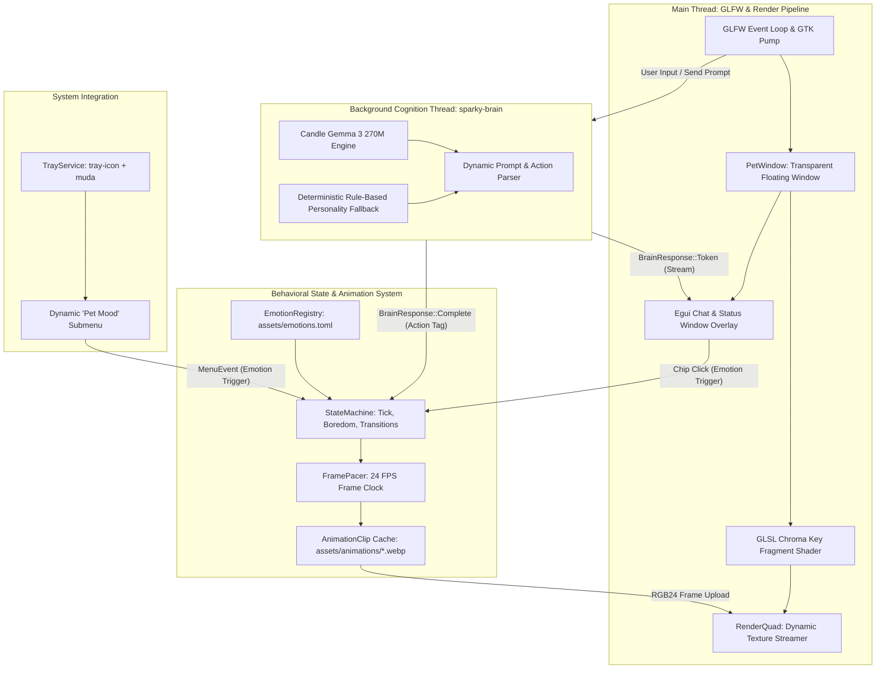
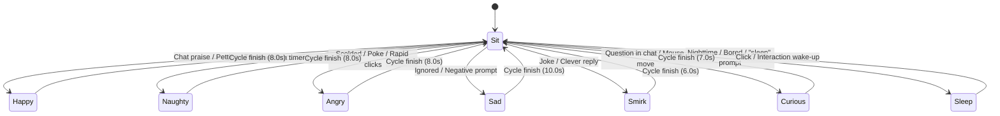
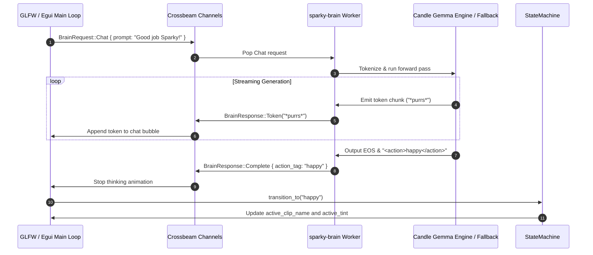

# Agent Operating Manual & Architecture Guide: Sparky Desktop Pet

> **System Name:** Sparky Desktop Pet (`sparky`)  
> **Repository Root:** `/home/kiddos/projects/tools/sparky`  
> **Language & Edition:** Rust 2024 (`rustc 1.99+`)  
> **Graphics Stack:** OpenGL 3.3 Core, GLFW (`glfw = "0.59"`, `gl = "0.14"`)  
> **Cognition Engine:** Google Gemma 3 270M IT (`google/gemma-3-270m-it`) via Hugging Face Candle (`candle-core = "0.8"`)  
> **GUI & System Integration:** Immediate-mode `egui` (`0.31`), `egui_gl_glfw` (`0.1.13`), `tray-icon` (`0.19`), `muda` (`0.15`), GTK 3 (`gtk = "0.18"`)  
> **Target OS:** Linux (X11 / XWayland), cross-platform extensible to macOS & Windows  

---

## 1. Project Overview & High-Level Architecture

Sparky is an ambient, ultra-low-resource hardware-accelerated desktop companion designed for software developers and power users. Visually manifested as a spirited, expressive kitten, Sparky floats seamlessly over desktop workspaces without window borders, decorations, or rectangular backgrounds.

Unlike typical Electron or web-wrapper desktop pets that consume hundreds of megabytes of memory and trigger continuous CPU interrupts, Sparky is built with strict systems engineering principles:
1. **Direct GPU Chroma Keying:** Pre-rendered video frames with green-screen backgrounds are keyed out on the GPU in a single pass using a custom GLSL fragment shader (`shaders/chroma.frag`), completely bypassing CPU alpha decompression and software blitting.
2. **Local Embedded Cognition:** Powered by an embedded Google Gemma 3 270M Instruction-Tuned (IT) language model running locally on CPU/AVX2 via Hugging Face Candle. When model weights are absent, a deterministic rule-based feline personality engine activates as a zero-dependency fallback.
3. **Data-Driven Emotion Architecture:** Behavior, loop modes, visual assets, fallback chains, and shader tints are declared dynamically in [`assets/emotions.toml`](file:///home/kiddos/projects/tools/sparky/assets/emotions.toml). No enum hardcoding is required to extend Sparky's emotional vocabulary.
4. **Zero-Overhead Ambient Pacing:** Frame pacing matches the source 24 FPS animation rate, using `glfw.wait_events_timeout()` to sleep the main thread between frames and achieve $< 0.3\%$ idle CPU.



---

## 2. Core Architectural Invariants & Resource Guarantees

Every agent modifying this codebase must adhere strictly to the following performance and design constraints:

| Metric / Subsystem | Hard Limit / Budget | Implementation Technique |
|:---|:---|:---|
| **Idle CPU (Sitting)** | $\le 0.3\%$ of 1 core | Event-driven sleep via `glfw.wait_events_timeout()` calculated from [`FramePacer`](file:///home/kiddos/projects/tools/sparky/src/animation/pacer.rs#L3-L9). |
| **Active CPU (Animation)** | $\le 1.8\%$ of 1 core | 24 FPS clamp; hardware chroma-keying; zero CPU alpha rasterization. |
| **Hidden CPU (Tray)** | $0.00\%$ | GLFW window unmapped (`pet_window.window.hide()`); rendering suspended; 100ms idle sleep. |
| **Resident Memory (RSS)** | $< 205\text{ MB}$ ($< 45\text{ MB}$ lazy) | Downscaled animation frames ($384 \times 216$ RGB24); memory-mapped safetensors (`mmap`). |
| **GPU Utilization** | $< 2.0\%$ on iGPU | Single textured quad VBO/VAO; no MSAA (`Samples(Some(0))`); simple fragment math. |
| **Thread Affinity** | Main Thread Only for GL | All OpenGL and GLFW calls **must** execute on the main thread. Worker threads communicate solely via `crossbeam-channel`. |
| **Linux GTK Pump** | Every loop tick | The GTK event loop (`gtk::main_iteration()`) must be pumped via `TrayService::pump_events()` on Linux to prevent system tray menu freezing. |

---

## 3. Directory Map & Codebase Anatomy

```
sparky/
├── Cargo.toml                      # Dependencies, build profile (opt-level=3, thin LTO, strip)
├── DESIGN.md                       # Comprehensive architectural specification and math formulation
├── IMPLEMENTATION.md               # Step-by-step implementation notes and verification matrix
├── AGENTS.md                       # (This file) Authoritative agent operating manual
├── .gitignore                      # Ignores /target, /.venv, /models
│
├── assets/
│   ├── animations/                 # Transcoded 384x216 24fps WebP animations (angry, happy, naughty, sit)
│   ├── emotions.toml               # Declarative emotion schema (prompt descriptions, loop modes, fallbacks)
│   └── icons/                      # System tray icons (optional custom icons)
│
├── animations/                     # Original high-res WebP reference assets (~4.4 MB each)
├── videos/                         # Original 720p/1080p MP4 reference video clips (angry, happy, naughty, sit)
│
├── shaders/
│   ├── quad.vert                   # Screen-space textured quad vertex shader with UV Y-flip
│   └── chroma.frag                 # CbCr chrominance distance keyer with green despill & emotion tint
│
├── scripts/
│   ├── download_gemma3_270m.sh     # HuggingFace downloader for Gemma 3 270M safetensors & tokenizer
│   └── transcode_assets.sh         # ffmpeg batch pipeline converting videos/*.mp4 -> assets/animations/*.webp
│
└── src/
    ├── main.rs                     # Entrypoint, window setup, main event loop, dual-viewport compositor
    │
    ├── animation/
    │   ├── mod.rs                  # Module exports for animation decoding and pacing
    │   ├── decoder.rs              # WebP decoding via image crate into raw RGB24 byte frames
    │   └── pacer.rs                # High-precision frame timing, delay calculation, and frame index stepping
    │
    ├── brain/
    │   ├── mod.rs                  # Module exports for LLM cognition engine
    │   ├── candle_engine.rs        # Worker thread, lazy model loading, Candle CPU forward pass & fallback
    │   └── prompt.rs               # Dynamic system prompt generation from registry, <action> tag extraction
    │
    ├── render/
    │   ├── mod.rs                  # PetWindow struct, GLFW transparent window initialization, drag & click-through
    │   ├── gl_helpers.rs           # check_gl_error helper
    │   ├── quad.rs                 # RenderQuad struct: VAO, VBO, dynamic 2D texture allocation and upload
    │   └── shader.rs               # ShaderProgram: GLSL compile, link, uniform setters (set_vec3, set_float)
    │
    ├── state/
    │   ├── mod.rs                  # Module exports for state machine and emotion registry
    │   ├── emotion.rs              # EmotionDefinition, LoopMode, EmotionRegistry TOML loader & fallback resolver
    │   └── machine.rs              # StateMachine: active emotion tracking, duration timers, boredom trigger
    │
    ├── tray/
    │   ├── mod.rs                  # Module exports for system tray
    │   └── service.rs              # TrayService: tray-icon + muda menu, dynamic mood submenu, procedural 32x32 icon
    │
    ├── rpc/
    │   ├── mod.rs                  # Module exports, re-exports, protocol test suite
    │   ├── behavior_tests.rs       # End-to-end pet behavioral & visual frame capture test suite
    │   ├── handler.rs              # RPC method dispatch, base64 encode/decode, PNG encoding, OpenRPC discovery
    │   ├── protocol.rs             # JSON-RPC 2.0 specifications (Request, Response, Error, ID, Batch)
    │   └── server.rs               # Dual HTTP/raw TCP server, GLFW wake notifier, connection worker pool
    │
    └── ui/
        ├── mod.rs                  # Module exports for immediate-mode UI
        └── chat_window.rs          # ChatState: egui dialogue overlay, message history, emotion chips, input handling
```

### Module Responsibilities Deep-Dive

#### 1. [`src/main.rs`](file:///home/kiddos/projects/tools/sparky/src/main.rs)
- **Application Orchestrator:** Initializes GLFW window, OpenGL context, emotion registry, WebP clips, system tray, brain worker, and egui overlay.
- **Dynamic Window & Viewport Management:**
  - Base pet window size: `BASE_WIDTH = 288`, `BASE_HEIGHT = 162`.
  - When the chat overlay is opened, the window expands vertically to `EXPANDED_HEIGHT = 466` (`BASE_HEIGHT + CHAT_EXTRA_HEIGHT`).
  - Viewport splitting: When chat is visible, kitten quad rendering is clamped to `gl::Viewport(0, 0, fb_w, kitten_fb_h)`, while egui renders to the full `gl::Viewport(0, 0, fb_w, fb_h)`.
- **Event Dispatching:** Pumps GLFW events into egui, checks pointer capture status (`egui_ctx.wants_pointer_input()`), forwards window dragging when egui does not capture the mouse, handles tray commands, and dispatches brain tokens.
- **Benchmarking & Profiling:** When run with `--profile-run`, samples CPU and RSS via `sysinfo` every 1 second, printing a benchmark summary after 10 seconds.

#### 2. [`src/animation/`](file:///home/kiddos/projects/tools/sparky/src/animation/mod.rs)
- [`decoder.rs`](file:///home/kiddos/projects/tools/sparky/src/animation/decoder.rs): Decodes WebP files using `image::codecs::webp::WebPDecoder`. Converts frames from `ImageRgba8` to `ImageRgb8` via `into_raw()`, storing them as flat RGB24 bytes (`384 * 216 * 3 = 248,832` bytes/frame).
- [`pacer.rs`](file:///home/kiddos/projects/tools/sparky/src/animation/pacer.rs): [`FramePacer`](file:///home/kiddos/projects/tools/sparky/src/animation/pacer.rs#L3-L9) tracks frame intervals ($1.0 / 24.0 \approx 41.66\text{ ms}$). `time_until_next_frame()` supplies the exact duration for `glfw.wait_events_timeout()` to eliminate CPU spinning.

#### 3. [`src/brain/`](file:///home/kiddos/projects/tools/sparky/src/brain/mod.rs)
- [`candle_engine.rs`](file:///home/kiddos/projects/tools/sparky/src/brain/candle_engine.rs):
  - Spawns a dedicated thread (`sparky-brain`) receiving [`BrainRequest`](file:///home/kiddos/projects/tools/sparky/src/brain/candle_engine.rs#L15-L20) and sending [`BrainResponse`](file:///home/kiddos/projects/tools/sparky/src/brain/candle_engine.rs#L22-L30) via crossbeam channels.
  - **Lazy Model Loading:** Defers loading weights into memory until the first chat prompt is sent.
  - **Gemma 3 Architecture:** Uses `candle_transformers::models::gemma3::Model` and maps safetensors via `VarBuilder::from_mmaped_safetensors` on CPU.
  - **Deterministic Feline Fallback:** If `models/gemma-3-270m` is absent, [`generate_fallback()`](file:///home/kiddos/projects/tools/sparky/src/brain/candle_engine.rs#L164-L265) provides rule-based prompt matching (treats, scolding, playing, sleep, curious) with realistic 40ms token streaming.
- [`prompt.rs`](file:///home/kiddos/projects/tools/sparky/src/brain/prompt.rs):
  - Dynamically builds Gemma chat formatting (`<start_of_turn>system...`) from [`EmotionRegistry::active_emotions()`](file:///home/kiddos/projects/tools/sparky/src/state/emotion.rs#L118-L120).
  - Extracts and strips `<action>([a-z0-9_-]+)</action>` tags from model output to trigger state transitions without displaying raw tags in dialogue.

#### 4. [`src/render/`](file:///home/kiddos/projects/tools/sparky/src/render/mod.rs)
- [`mod.rs`](file:///home/kiddos/projects/tools/sparky/src/render/mod.rs): Configures GLFW window hints for borderless (`Decorated(false)`), floating (`Floating(true)`), transparent (`TransparentFramebuffer(true)`), unresizable (`Resizable(false)`) rendering. Implements displacement-compensated, jitter-free mouse dragging tracking `current_pos`, synchronized `set_pos` / `get_pos`, focus-loss drag cancellation, and click-through mode.
- [`quad.rs`](file:///home/kiddos/projects/tools/sparky/src/render/quad.rs): Allocates VAO/VBO for a full-quad `TRIANGLE_STRIP` ($[-1, 1]$ coordinate space) and manages the OpenGL texture unit (`GL_TEXTURE0`).
- [`shader.rs`](file:///home/kiddos/projects/tools/sparky/src/render/shader.rs): Compiles vertex and fragment shaders from disk, links the OpenGL program, and exposes type-safe uniform setters (`set_vec3`, `set_float`, `set_int`).

#### 5. [`src/state/`](file:///home/kiddos/projects/tools/sparky/src/state/mod.rs)
- [`emotion.rs`](file:///home/kiddos/projects/tools/sparky/src/state/emotion.rs):
  - Deserializes [`assets/emotions.toml`](file:///home/kiddos/projects/tools/sparky/assets/emotions.toml) into [`EmotionRegistry`](file:///home/kiddos/projects/tools/sparky/src/state/emotion.rs#L57-L61).
  - Scans `assets/animations/` for available `.webp` files.
  - **Fallback Visual Resolver:** Resolves missing assets through configured `fallback` keys (e.g. `sad` falls back to `sit` with a cold blue tint `[0.80, 0.85, 1.05]`; `smirk` falls back to `naughty`).
- [`machine.rs`](file:///home/kiddos/projects/tools/sparky/src/state/machine.rs):
  - [`StateMachine`](file:///home/kiddos/projects/tools/sparky/src/state/machine.rs#L4-L10) manages transitions and lifecycle rules.
  - `LoopMode::OnceThenReturn`: Plays for `duration_secs`, then returns to `return_to` (default `sit`).
  - `LoopMode::Loop`: Loops continuously.
  - Boredom timer: If pet sits idle without interaction for $> 180\text{ seconds}$, automatically triggers `naughty`.

#### 6. [`src/tray/`](file:///home/kiddos/projects/tools/sparky/src/tray/mod.rs)
- [`service.rs`](file:///home/kiddos/projects/tools/sparky/src/tray/service.rs): Encapsulates system tray initialization and event loop pumping using `tray-icon`, `muda`, and GTK. Dynamically generates the "🐾 Pet Mood" submenu from all entries in `EmotionRegistry`. Generates a fallback 32x32 RGBA orange kitten icon procedurally if `assets/icons/sparky_tray.png` is not provided.

#### 7. [`src/ui/`](file:///home/kiddos/projects/tools/sparky/src/ui/mod.rs)
- [`chat_window.rs`](file:///home/kiddos/projects/tools/sparky/src/ui/chat_window.rs): Immediate-mode chat panel with conversation history, current mood badge (`[😺 Happy]`, `[😏 Smirk]`), thinking indicator, and dynamic suggestion chips derived directly from `EmotionRegistry`.

#### 8. [`src/rpc/`](file:///home/kiddos/projects/tools/sparky/src/rpc/mod.rs)
- **JSON-RPC 2.0 Dual Transport Server:** Exposes a high-performance, non-blocking JSON-RPC 2.0 interface supporting both HTTP POST (with CORS headers for web/tool integration) and raw line-delimited TCP (for scripts, `nc`, and IPC) on the same port (default `127.0.0.1:6006`).
- **GLFW Event Loop Waking:** Uses [`GlfwWakeNotifier`](file:///home/kiddos/projects/tools/sparky/src/rpc/server.rs) (`glfw.post_empty_event()`) to wake up the main thread instantly upon receiving remote commands, guaranteeing $\le 0.3\%$ idle CPU without polling.
- **Remote Operations:** Supports controlling emotions (`sparky.set_emotion`), pet status inspection (`sparky.get_state`), visual display frame capture (`sparky.get_frame`), interactions (`sparky.pet`, `sparky.poke`), AI chat generation (`sparky.send_chat`, `sparky.get_chat_history`), window geometry & click-through (`sparky.set_position`, `sparky.set_visible`, `sparky.set_click_through`), and introspection (`rpc.discover`, `sparky.list_emotions`).
- **Frame Capture & Visual Verification:** `sparky.get_frame` captures raw clip frames or rendered framebuffers as base64 PNGs with disk saving (`save_path`), allowing remote visual verification.
- **Behavioral Test Suite ([`src/rpc/behavior_tests.rs`](file:///home/kiddos/projects/tools/sparky/src/rpc/behavior_tests.rs)):** Automated test harness driving the pet state machine, windowing, and frame decoding over persistent TCP sockets with terminal ANSI truecolor visualization.

#### 9. [`shaders/`](file:///home/kiddos/projects/tools/sparky/shaders/)
- [`quad.vert`](file:///home/kiddos/projects/tools/sparky/shaders/quad.vert): Positions quad vertices and flips texture Y coordinate: `TexCoord = vec2(aTexCoord.x, 1.0 - aTexCoord.y)`.
- [`chroma.frag`](file:///home/kiddos/projects/tools/sparky/shaders/chroma.frag):
  - Converts RGB to normalized CbCr chrominance:
    $$Cb = -0.168736 R - 0.331264 G + 0.5 B + 0.5$$
    $$Cr = 0.5 R - 0.418688 G - 0.081312 B + 0.5$$
  - Measures Euclidean distance $d$ to target green $(Cb_{key}, Cr_{key})$.
  - Calculates alpha via `smoothstep(u_Threshold, u_Threshold + u_Softness, dist)`.
  - Suppresses green despill bleed on fur: `despilledRGB.g = mix(despilledRGB.g, max(R, B), u_Despill)`.
  - Multiplies final color by `u_EmotionTint` for mood tinting.
  - Clears letterbox/encoding black borders by feathering alpha across `u_BorderMargin` / `u_BorderFeather` and suppressing dark edge artifacts.

---

## 4. Control Loops & Data Flow

### 4.1. Pet State Transition Graph



### 4.2. Cognitive Inference Sequence



---

## 5. Developer & Agent Workflows

### 5.1. System Prerequisites (Linux)
Ensure development libraries are installed:
```bash
# Ubuntu / Debian
sudo apt-get update && sudo apt-get install -y \
    build-essential cmake pkg-config \
    libglfw3-dev libgl1-mesa-dev libx11-dev libxcursor-dev \
    libxrandr-dev libxinerama-dev libxi-dev \
    libgtk-3-dev libayatana-appindicator3-dev libxdo-dev ffmpeg

# Fedora
sudo dnf install -y \
    gcc gcc-c++ cmake pkgconf-pkg-config \
    glfw-devel mesa-libGL-devel libX11-devel libXcursor-devel \
    libXrandr-devel libXinerama-devel libXi-devel \
    gtk3-devel libappindicator-gtk3-devel libxdo-devel ffmpeg

# Arch Linux
sudo pacman -S --needed \
    base-devel cmake pkgconf glfw-x11 mesa \
    libx11 libxcursor libxrandr libxinerama libxi \
    gtk3 libappindicator-gtk3 xdotool ffmpeg
```

### 5.2. Build, Test, and Quality Commands

| Task | Command | Purpose / Notes |
|:---|:---|:---|
| **Build (Debug)** | `cargo build` | Fast incremental compilation for development. |
| **Build (Release)** | `cargo build --release` | Maximum optimizations (`opt-level = 3`, LTO, strip). |
| **Run All Tests (Release)** | `cargo test --release` | Runs all 34 tests with optimized WebP decoding (~11s). |
| **Run All Tests (Debug)** | `cargo test` | Runs all unit and behavioral tests. |
| **Run Behavioral Tests** | `cargo test rpc::behavior_tests -- --nocapture` | Runs RPC behavioral tests with live ANSI terminal frame visualizers. |
| **Test Specific Module** | `cargo test state::emotion` | Isolates emotion registry and fallback test suite. |
| **Lint Check** | `cargo clippy --all-targets` | Checks for idioms and anti-patterns. |
| **Format Check** | `cargo fmt --check` | Enforces Rust formatting standards. |
| **Run Desktop Pet** | `cargo run --release` | Launches Sparky on desktop. |
| **Package AppImage** | `./scripts/package_appimage.sh --test` | Packages standalone AppImage bundle and runs validation tests. |
| **Benchmark / Profile Run** | `cargo run --release -- --profile-run` | Runs 10s automated session, reporting FPS, CPU%, and peak RAM. |

### 5.3. Asset Preparation & Model Setup

#### 1. Transcode Video Clips to WebP
Whenever new clips are added to `videos/*.mp4`:
```bash
./scripts/transcode_assets.sh
```
This downscales clips to $384 \times 216$ at 24 FPS with lossless WebP compression into `assets/animations/`.

#### 2. Download Gemma 3 270M Model Weights (Optional)
To enable real local LLM inference instead of the built-in fallback:
```bash
./scripts/download_gemma3_270m.sh models/gemma-3-270m
```
Downloads `config.json`, `tokenizer.json`, and `model.safetensors` from Hugging Face (`google/gemma-3-270m-it`).

---

## 6. Extensibility Recipes

### Recipe 1: Adding a New Emotion

To add an emotion (e.g. `proud`):

#### Option A: Config-Only with Fallback (Zero Asset Required)
Edit [`assets/emotions.toml`](file:///home/kiddos/projects/tools/sparky/assets/emotions.toml):
```toml
[emotions.proud]
name = "Proud"
emoji = "🦁"
asset = "proud.webp"
fallback = "happy"                     # Falls back to happy animation
shader_tint = [1.1, 1.0, 0.9]          # Warm golden aura
loop_mode = "OnceThenReturn"
return_to = "sit"
duration_secs = 6.0
prompt_description = "triumphant, chest puffed out, accomplished, proud"
```
*Effect:*
- Gemma's prompt immediately incorporates `<action>proud</action>`.
- System tray Pet Mood submenu immediately displays `🦁 Proud`.
- Chat window includes a `🦁 Proud` suggestion chip.
- When triggered, plays `happy.webp` with the golden shader tint and reports `[🦁 Proud]` in the chat window.

#### Option B: Full Emotion with Dedicated Video
1. Place `proud.mp4` in `videos/`.
2. Run `./scripts/transcode_assets.sh` (produces `assets/animations/proud.webp`).
3. Define `[emotions.proud]` in `assets/emotions.toml`.

### Recipe 2: Tuning GPU Chroma-Keying, Despill & Border Transparency
If green fringes appear, kitten fur edges are overly cut, or video letterbox borders bleed through:
1. Open [`shaders/chroma.frag`](file:///home/kiddos/projects/tools/sparky/shaders/chroma.frag) or update uniforms in [`src/main.rs`](file:///home/kiddos/projects/tools/sparky/src/main.rs#L153-L161):
   - `u_Threshold` (default `0.32`): Lower value tightens keying; higher value keys out more greenish tints.
   - `u_Softness` (default `0.12`): Controls edge feathering width.
   - `u_Despill` (default `0.85`): Factor for suppressing green reflections on white/orange fur.
   - `u_BorderMargin` (default `vec2(0.015, 0.015)`): Width of edge margin where alpha is forced to 0 to eliminate encoding/letterbox black bars.
   - `u_BorderFeather` (default `vec2(0.005, 0.005)`): Transition feathering width between border margin and interior frame.

---

## 7. Critical Invariants, Guardrails & Anti-Patterns

> [!CAUTION]
> **Never violate these rules when editing Sparky:**

1. **NO Busy-Polling Loops:**
   - **Bad:** `loop { glfw.poll_events(); render(); }`
   - **Good:** Always compute sleep duration via `frame_pacer.time_until_next_frame()` and pass it to `glfw.wait_events_timeout()`.
2. **NO OpenGL Calls off Main Thread:**
   - The GLFW OpenGL context is owned exclusively by the main thread. Never invoke `gl::*` or access `PetWindow` from worker threads.
3. **NEVER Omit GTK Pumping on Linux:**
   - `tray-icon` and `muda` rely on GTK under Linux. Pumping via `tray.pump_events()` in the main loop is strictly mandatory.
4. **NO CPU-Side Chroma Keying or Alpha Blitting:**
   - All animation frames are passed as raw RGB24 to OpenGL. Keying is done on GPU in `chroma.frag`. Do not add CPU pixel loop masks.
5. **NO Hardcoded Emotion Enums:**
   - Always load emotions through [`EmotionRegistry`](file:///home/kiddos/projects/tools/sparky/src/state/emotion.rs#L57-L61). Do not hardcode static enums or switches over emotion names in code.
6. **Preserve Sub-Viewport Geometry:**
   - When chat is visible, remember that `quad.draw()` requires `gl::Viewport(0, 0, fb_w, kitten_fb_h)`, and egui requires `gl::Viewport(0, 0, fb_w, fb_h)`. Never mix these viewports.
7. **NEVER Key Out Black Globally:**
   - Source animation frames often contain black letterbox lines at frame edges, but the pet's eyes, pupils, mouth, and fur contours contain pure black pixels (`RGB = 0, 0, 0`).
   - Never apply global black chroma-keying or luminance thresholding across the entire quad. Always bound border/black suppression strictly to frame edges (`minEdgeDist < 0.05`).
8. **GLFW Single-Thread Test Serialization:**
   - `PetWindow` and GLFW context functions are bound to a single thread. In multi-threaded `cargo test` runs, tests that initialize `PetWindow` must synchronize via a mutex (e.g., `TEST_HARNESS_LOCK: Mutex<()>`) or run sequentially to avoid GLFW context collision.
9. **Threaded Event Pump Exit Guard (`client_handle.is_finished()`):**
   - When a test pumps the main loop while driving an RPC client from a spawned thread, NEVER loop on a bare boolean flag (`while !is_done`). If an assertion panics in the client thread, the flag is never set, deadlocking the harness and starving locks.
   - ALWAYS poll `while !client_handle.is_finished() { ... }`, drain remaining commands, and call `client_handle.join().unwrap()` to cleanly propagate panics.
10. **Static Asset Caching in Test Suites (`LazyLock`):**
    - Multi-frame WebP assets (`AnimationClip::load_from_webp`) are expensive to decode on CPU in debug builds.
    - Never reload clips inside each individual test function; cache them statically using `std::sync::LazyLock` (`TEST_CLIPS`, `TEST_REGISTRY`).
11. **JSON-RPC 2.0 Error Context Invariant (`data` vs `message`):**
    - Under the JSON-RPC 2.0 protocol implementation, `RpcError::invalid_params` produces `"message": "Invalid params"`.
    - Detailed context (e.g. `"Unknown emotion '...'. Available: [...]"`) is stored in the `"data"` field. Test assertions and API consumers must inspect `error["data"]` rather than `error["message"]`.
12. **Window-Relative Cursor Drag Compensation (Anti-Jitter Invariant):**
    - GLFW's `WindowEvent::CursorPos(cx, cy)` supplies coordinates relative to the window's content area, NOT global screen coordinates.
    - Physically moving the window shifts the client area under the pointer, which alters `(cx, cy)` for subsequent events.
    - **Bad (Jitter Loop):**
      ```rust
      let dx = (cx - self.drag_start_cursor.0) as i32;
      self.window.set_pos(self.drag_start_pos.0 + dx, self.drag_start_pos.1 + dy);
      ```
      *Failure Mode:* Moving the window by $+10\text{ px}$ causes the next relative cursor position `cx` to drop back by $-10\text{ px}$, resulting in `dx = 0` and snapping the window back to `drag_start_pos` every frame.
    - **Good (Displacement-Compensated Invariant):**
      ```rust
      let actual_cx = cx + (self.current_pos.0 - self.drag_start_pos.0) as f64;
      let actual_cy = cy + (self.current_pos.1 - self.drag_start_pos.1) as f64;
      let dx = (actual_cx - self.drag_start_cursor.0) as i32;
      let dy = (actual_cy - self.drag_start_cursor.1) as i32;
      let target_x = self.drag_start_pos.0 + dx;
      let target_y = self.drag_start_pos.1 + dy;
      if target_x != self.current_pos.0 || target_y != self.current_pos.1 {
          self.set_pos(target_x, target_y);
      }
      ```
      *Invariant:* Adding the accumulated displacement `(current_pos - drag_start_pos)` mathematically reconstructs the invariant screen-space displacement `current_screen_cursor - initial_screen_cursor`.
    - **Drag Event Loop Pacing:**
      - During active dragging (`pet_window.is_dragging == true`), lower `glfw.wait_events_timeout()` to $5\text{ ms}$ (~$200\text{ Hz}$) for fluid cursor tracking.
      - Return to `frame_pacer.time_until_next_frame()` ($24\text{ FPS}$) when not dragging to strictly maintain the $\le 0.3\%$ idle CPU budget.
    - **Drag Gesture Isolation:**
      - Never allow UI overlays to cancel an in-flight window drag:  
        `let pointer_captured_by_egui = !pet_window.is_dragging && chat_state.is_visible && egui_ctx.wants_pointer_input();`
13. **Visual Verification & Screen Inspection Invariant (`sparky.get_frame`):**
    - Never attempt to run external X11/Wayland screen capture commands (`import -window root`, `scrot`, `xwd`, `maim`).
    - Use the built-in JSON-RPC method `sparky.get_frame` with `source: "framebuffer"`, saving to disk via `save_path`.
    - Once written to disk, call `read_file` on the PNG path to inspect and analyze the rendered frame directly within the agent context.
    - Capturing from `source: "framebuffer"` captures the exact composited result (`gl::ReadPixels`), including transparent alpha blending, chroma despill, and the egui chat overlay.
14. **Dual-Viewport & Dynamic Window Expansion Invariant:**
    - Base pet dimensions: $288 \times 162\text{ px}$. Expanded chat dimensions: $288 \times 466\text{ px}$ (`BASE_HEIGHT + CHAT_EXTRA_HEIGHT`).
    - Whenever the window size changes (`chat_state.is_visible` toggle or `WindowEvent::FramebufferSize`):
      1. `painter.set_size(nfb_w, nfb_h)` must be called on `egui_gl_glfw::Painter` to update its projection uniform `u_screen_size` and viewport/scissor math.
      2. `egui_input_state.input.screen_rect` must be set to `Rect::from_min_size(Pos2::ZERO, vec2(win_w, win_h))`.
    - Failure to update `painter.set_size` will cause egui to render using the initial $162\text{px}$ canvas height, resulting in squashed fonts, truncated UI elements, and inaccessible text inputs.

### Shell Tool Preferences
When executing CLI commands or editing files, adhere to:
- `fd` instead of `find`
- `rg` instead of `grep`
- `bat -n` instead of `cat`
- `sd` instead of `sed`
- `xcp` instead of `cp`

---

## 8. Technical Debt & Future Roadmap

1. **Native Wayland Floating Transparent Window Support:**
   - GLFW relies on X11 / XWayland protocols. Modern Wayland compositors (Sway, Hyprland, GNOME Wayland) require custom subsurfaces or `wlr-layer-shell` protocols for floating transparent overlays.
2. **Quantized Candle LLM (INT4 / Q4_K):**
   - Upgrade Gemma 3 270M from FP32 to `candle-quantized` Q4_K to reduce weight memory footprint from $\approx 540\text{ MB}$ to $< 150\text{ MB}$.
3. **Procedural Audio Effects:**
   - Integrate lightweight sound synthesis (`rodio`) for purring, soft meows, and hisses synchronized with emotion transitions.
4. **Interactive Pet Physics:**
   - Screen edge bounding, gravity falling animation when dropped, and cursor following pounce behavior.
