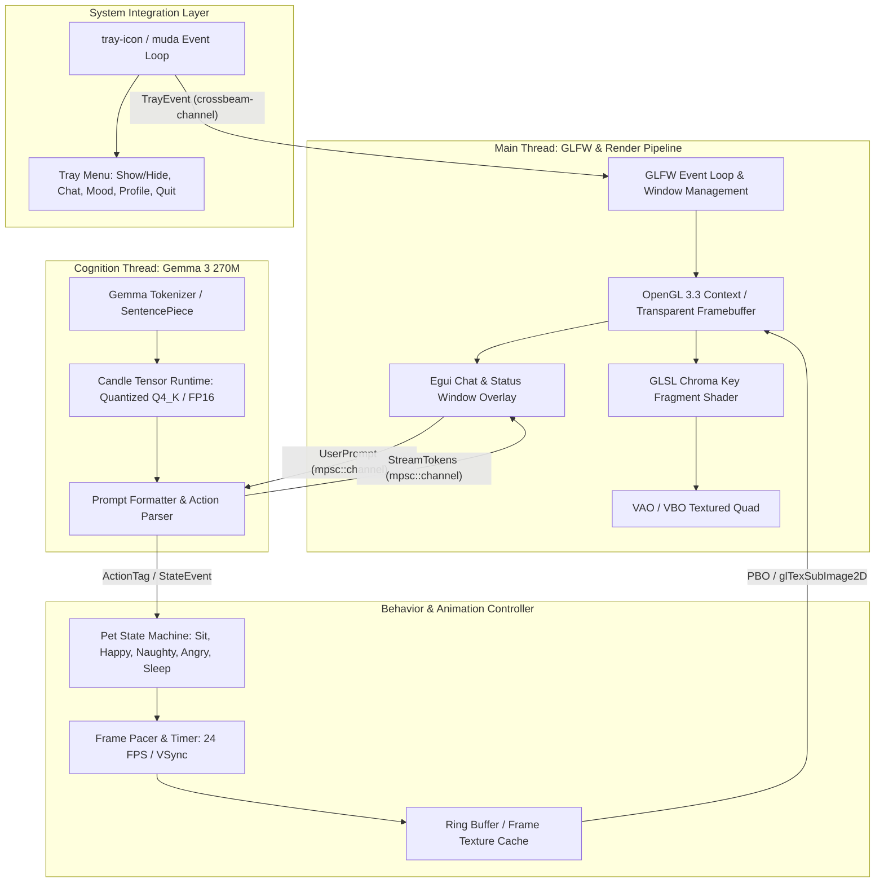
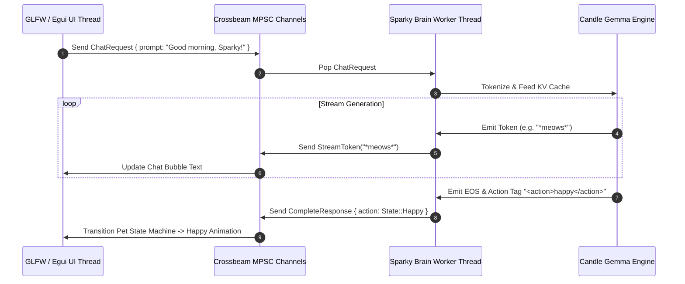
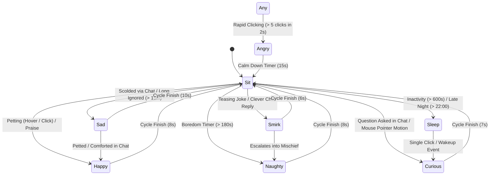

# Sparky the Kitten: Desktop Pet Architecture & Design Specification

> **System Name:** Sparky Desktop Pet (`sparky`)  
> **Target Platform:** Linux (X11 / Wayland via XWayland), cross-platform extensible to macOS & Windows  
> **Language & Toolchain:** Rust 2024 edition (`rustc 1.90+`), OpenGL 3.3 Core, GLFW  
> **Intelligence Core:** Google Gemma 3 270M IT (`google/gemma-3-270m-it`) via Candle  
> **Status:** Architecture & Design Specification  

---

## 1. Executive Summary & Vision

**Sparky** is an ambient, low-resource desktop companion designed for developers and power users. Visually manifested as a spirited, expressive kitten, Sparky roams, sits, snores, and plays directly on top of the user's desktop workspace. Unlike heavyweight web-based or Electron-based desktop pets that consume hundreds of megabytes of RAM and induce continuous CPU wakeups, Sparky is engineered in pure **Rust** with direct **OpenGL / GLFW hardware acceleration** and zero-overhead GPU chroma keying.

Sparky's cognition is driven locally by an embedded **Google Gemma 3 270M Instruction-Tuned (IT)** model. This ultra-compact language model gives Sparky personality, context-aware conversational abilities, emotional variance, and autonomous behavioral agency—all running locally on user hardware with INT4/INT8 quantization without cloud API dependencies or recurring telemetry costs.

### Core Architectural Axioms
1. **Zero-Impact Ambient Footprint:** Idle CPU usage must remain $< 0.3\%$, active animation CPU $< 2.0\%$, and idle RAM $< 180\text{ MB}$ (with quantized LLM loaded) or $< 40\text{ MB}$ (with lazy LLM paging).
2. **True Alpha Blending via Hardware Chroma Keying:** Pre-rendered video animations encoded with green-screen backgrounds are keyed out on the GPU in a single pass using an optimized GLSL fragment shader, eliminating CPU alpha decompression overhead.
3. **Non-Blocking Autonomous Cognition:** Inference and token generation execute on a detached background worker thread with low thread priority. The UI and animation render loops never hitch or drop frames during model generation.
4. **Seamless System Integration:** Sparky features an unobtrusive system tray controller, click-through mode, window dragging, and a toggled conversational interface built on lightweight immediate-mode GUI (`egui`).

---

## 2. System Architecture & Component Diagram

Sparky is structured around an asynchronous, decoupled multi-threaded architecture. The main thread manages OS windowing, event polling, and OpenGL rendering. Background workers handle animation frame decoding, system tray event routing, and local Gemma inference.



---

## 3. Video & Asset Pipeline

### 3.1. Source Assets and Transcoding Workflow
The visual source of Sparky consists of video clips located in `videos/`. The emotion pipeline is fully dynamic and scans for all available clips:
- Standard emotions:
  - `videos/sit.mp4`: Idle sitting, blinking, breathing, tail swishing.
  - `videos/happy.mp4`: Purring, head bobbing, playful paw tapping.
  - `videos/naughty.mp4`: Pouncing, swiping at the cursor, mischievous head tilts.
  - `videos/angry.mp4`: Hissing posture, arched back, ear twitching.
- Expandable / custom emotions (e.g. user or artist contributed):
  - `videos/sad.mp4`: Drooping ears, whimpering posture, looking down.
  - `videos/smirk.mp4`: Half-closed eyes, sly sideways grin, confident paw tap.
  - `videos/curious.mp4`: Head cocked, ears perked, investigating.
  - `videos/sleep.mp4`: Curled into a ball, rhythmic chest rising.
  - `videos/wakeup.mp4`: Big stretch, yawning, shaking fur.

The asset pipeline script `scripts/transcode_assets.sh` is fully dynamic: it automatically iterates over all `*.mp4` files present in `videos/` and produces optimized WebP assets in `assets/animations/`:
```bash
for video in videos/*.mp4; do
    [ -f "$video" ] || continue
    name="$(basename "$video" .mp4)"
    # Transcodes to assets/animations/$name.webp
done
```

### 3.2. Texture Memory Budget Analysis
The source video resolution is $1280 \times 720$ at 24 FPS. For an 8-second clip (192 frames):
- Raw uncompressed $1280 \times 720 \times 4$ (RGBA) = $3.68\text{ MB}$ per frame $\times 192 = 707.8\text{ MB}$ VRAM!
- **Target Desktop Pet Scale:** A desktop pet typically renders at $320 \times 180$ display pixels (or $640 \times 360$ for $2\times$ Retina/HiDPI).
- At $320 \times 180 \times 3$ (RGB24, since alpha is calculated on GPU):
  $$\text{Per-frame size} = 320 \times 180 \times 3 = 172.8\text{ KB}$$
  $$192\text{ frames} = 33.1\text{ MB}$$
- By decoding or pre-scaling animation frames to target pet dimension ($320 \times 180$), all 4 state animations fit comfortably within $\approx 100\text{ MB}$ of system RAM, or dynamically streamed via a ring buffer consuming $< 15\text{ MB}$.

### 3.3. Real-Time GPU Chroma Keying Algorithm
Rather than performing costly CPU-based alpha matte calculation on every frame, the video is kept as RGB24 and passed directly to the GPU. The GLSL fragment shader eliminates the green background in real time.

#### Mathematical Formulation for Chroma Keying
Simple Euclidean RGB distance causes artifacts on shadows and highlights. Instead, Sparky utilizes a chrominance-distance keyer with green despill suppression:

1. **Color Space Conversion (RGB $\to$ Normalized Chrominance $CbCr$):**
   $$Y = 0.299 R + 0.587 G + 0.114 B$$
   $$Cb = -0.168736 R - 0.331264 G + 0.5 B + 0.5$$
   $$Cr = 0.5 R - 0.418688 G - 0.081312 B + 0.5$$

2. **Distance to Target Key Color:**
   Given key color chrominance $(Cb_{key}, Cr_{key})$:
   $$d = \sqrt{(Cb - Cb_{key})^2 + (Cr - Cr_{key})^2}$$

3. **Alpha Feathering:**
   $$\alpha = \text{smoothstep}(T_{inner}, T_{outer}, d)$$
   Where $T_{inner}$ is the similarity threshold and $T_{outer} = T_{inner} + \text{smoothness}$.

4. **Green Despill (Suppressing green reflections on cat fur):**
   $$G_{spill} = \min(G, \max(R, B))$$
   $$RGB_{final} = (R, G_{spill}, B)$$

#### GLSL Fragment Shader (`chroma.frag`)
```glsl
#version 330 core
in vec2 TexCoord;
out vec4 FragColor;

uniform sampler2D u_Texture;
uniform vec3 u_KeyColorRGB;   // e.g. vec3(0.0, 1.0, 0.0)
uniform float u_Threshold;    // e.g. 0.35
uniform float u_Softness;     // e.g. 0.15
uniform float u_Despill;      // e.g. 0.8

vec2 rgbToCbCr(vec3 rgb) {
    float cb = -0.168736 * rgb.r - 0.331264 * rgb.g + 0.500000 * rgb.b + 0.5;
    float cr =  0.500000 * rgb.r - 0.418688 * rgb.g - 0.081312 * rgb.b + 0.5;
    return vec2(cb, cr);
}

void main() {
    vec4 texColor = texture(u_Texture, TexCoord);
    vec2 pixelCbCr = rgbToCbCr(texColor.rgb);
    vec2 keyCbCr = rgbToCbCr(u_KeyColorRGB);

    float dist = distance(pixelCbCr, keyCbCr);
    float alpha = smoothstep(u_Threshold, u_Threshold + u_Softness, dist);

    // Despill: Prevent green fringes on fur
    float maxRB = max(texColor.r, texColor.b);
    vec3 despilledRGB = texColor.rgb;
    if (despilledRGB.g > maxRB) {
        despilledRGB.g = mix(despilledRGB.g, maxRB, u_Despill);
    }

    FragColor = vec4(despilledRGB, alpha * texColor.a);
}
```

---

## 4. Rendering Engine (OpenGL 3.3 Core & GLFW)

### 4.1. Transparent, Borderless, Floating Window Configuration
To render Sparky directly onto the desktop wallpaper without a surrounding window box:
- **Transparent Framebuffer:** GLFW window hint `glfw::WindowHint::TransparentFramebuffer(true)`.
- **Borderless / Undecorated:** `glfw::WindowHint::Decorated(false)`.
- **Always On Top:** `glfw::WindowHint::Floating(true)`.
- **Resizable Disabled:** `glfw::WindowHint::Resizable(false)`.
- **Color Buffer Blending:**
  ```rust
  gl::Enable(gl::BLEND);
  gl::BlendFunc(gl::SRC_ALPHA, gl::ONE_MINUS_SRC_ALPHA);
  ```

### 4.2. Drag-and-Drop Positioning & Mouse Passthrough
Sparky supports two window interaction modes:
1. **Interactive Mode (Default):**
   - Left-click on Sparky captures mouse coordinates for dragging Sparky anywhere on the screen.
   - Right-click brings up the quick action context menu.
   - Double-click toggles the Chat Dialogue.
2. **Click-Through Mode:**
   - Setting GLFW hint `glfw::WindowHint::MousePassthrough(true)` allows mouse events to pass directly through Sparky to background windows, ideal when working without distraction.
   - Click-through is easily toggled via the system tray menu or global shortcut.

### 4.3. Texture Streaming via Pixel Buffer Objects (PBO)
To eliminate CPU-GPU pipeline stalls when uploading frames at 24 FPS:
- Utilize **asynchronous dual-PBO ring buffers**:
  - PBO 0 uploads frame $N$ to the GPU while CPU copies frame $N+1$ into mapped memory of PBO 1.
  - Transfer is performed with `glBufferData(GL_PIXEL_UNPACK_BUFFER, ..., GL_STREAM_DRAW)`.
  - CPU render thread execution time per frame drops from $\approx 2.5\text{ ms}$ to $< 0.1\text{ ms}$.

---

## 5. The Brain: Gemma 3 270M Cognition Engine

### 5.1. Model Architecture & Selection
Google's **Gemma 3 270M IT** (`google/gemma-3-270m-it`) is selected as Sparky's cognitive core:
- **Parameter Count:** $\approx 270\text{ Million}$ parameters.
- **Context Window:** 2,048 tokens (tailored for desktop dialogue).
- **Execution Engine:** Hugging Face **Candle** (`candle-core`, `candle-transformers`, `candle-nn`).
- **Quantization:** INT4 / INT8 quantized safetensors (`candle-quantized`) reducing runtime weight memory from $\approx 540\text{ MB}$ to $\approx 150\text{ MB}$.
- **Download Automation:** Managed via `scripts/download_gemma3_270m.sh` retrieving:
  - `config.json`
  - `tokenizer.json`
  - `model.safetensors`

### 5.2. Asynchronous Thread Isolation Architecture
The LLM inference loop must never run on the GLFW main thread. A dedicated worker thread manages the Candle model:



### 5.3. Dynamic Prompt Engineering & Extensible Action Grammar
Sparky's system prompt enforces a kitten persona while emitting structured behavioral control codes that drive the pet's animation state machine. Rather than using a hardcoded enum list, **the prompt is dynamically generated from the registered emotions in `EmotionRegistry`**:

#### Dynamic System Prompt Generation
```rust
let emotion_guidelines = emotion_registry
    .active_emotions()
    .map(|e| format!("<action>{}</action> - {}", e.id, e.prompt_description))
    .collect::<Vec<_>>()
    .join("\n");

let system_prompt = format!(
    "<start_of_turn>system\n\
    You are Sparky, an intelligent, charming, and slightly mischievous desktop kitten.\n\
    You live on the user's desktop. Your responses should be concise, playful, and express feline instincts.\n\
    At the very end of your response, ALWAYS append an action tag reflecting your emotional state:\n\
    {}\n\
    Do not include any other XML tags. Keep dialogue under 40 words.<end_of_turn>",
    emotion_guidelines
);
```

#### Example Generated Prompt (with Base + Extended Emotions)
```markdown
<start_of_turn>system
You are Sparky, an intelligent, charming, and slightly mischievous desktop kitten.
You live on the user's desktop. Your responses should be concise, playful, and express feline instincts.
At the very end of your response, ALWAYS append an action tag reflecting your emotional state:
<action>sit</action> - calm, content, neutral, observing
<action>happy</action> - affectionate, praised, petted, ecstatic, purring
<action>naughty</action> - playful, mischievous, swiping, energetic
<action>angry</action> - provoked, startled, irritated, defensive hiss
<action>sad</action> - neglected, scolded, whimpering, lonely, drooping ears
<action>smirk</action> - sly, cheeky, sarcastic, knowing grin, mischievous scheme
<action>curious</action> - intrigued by questions, tilting head, investigating
<action>sleep</action> - tired, lazy, nighttime, bored, curled up
Do not include any other XML tags. Keep dialogue under 40 words.<end_of_turn>
<start_of_turn>user
{USER_INPUT}<end_of_turn>
<start_of_turn>model
```

#### Extensible Action Parsing Logic
The response processor runs an open-ended regex / parser extracting `<action>([a-z0-9_-]+)</action>`:
1. The tag is extracted and stripped from the user-visible chat bubble.
2. The extracted ID is queried against `EmotionRegistry`:
   - **Direct Match with Asset:** If the asset (`.webp`) is present in `assets/animations/`, Sparky transitions immediately to this animation.
   - **Asset-Free / Virtual Emotion (Fallback):** If an emotion is defined in configuration but its dedicated video has not yet been rendered, the engine gracefully transitions to its defined `fallback_id` (e.g. `smirk` falls back to `naughty`, `sad` falls back to `sit` with a muted blue shader tint) while displaying the emotion's flavor text in the chat bubble (e.g. `*Sparky gives a sly smirk*`).
3. An `AppEvent::EmotionTriggered(emotion_id)` is dispatched to the state machine and UI event stream.

---

## 6. Desktop Integration & UI

### 6.1. Dynamic System Tray Controller (`tray-icon` + `muda`)
The system tray resides in the OS notification area (Linux SNI / StatusNotifierItem), serving as the master control hub. Crucially, the **"Pet Mood" submenu is dynamically populated at runtime** from all registered emotions:

```
[ Sparky Kitten Icon ]
├── 👁️ Show / Hide Sparky (Checked/Unchecked toggle)
├── 💬 Open Chat Window (Toggle)
├── 🐾 Pet Mood (Dynamically Generated from Registry)
│    ├── ⚪ Sit (Idle)
│    ├── 🟢 Happy
│    ├── 🟡 Naughty
│    ├── 🔴 Angry
│    ├── 🔵 Sad (Extended)
│    ├── 🟣 Smirk (Extended)
│    ├── 🔍 Curious (Extended)
│    └── 💤 Sleep
├── 🔒 Click-Through Mode (Toggle)
├── ⚡ Low Power Mode (12 FPS throttle)
├── 📊 Resource Stats: CPU 0.4% | RAM 165MB
└── ❌ Exit Sparky
```

When Sparky is hidden:
- The GLFW window is unmapped (`window.hide()`).
- OpenGL draw calls and WebP frame decoding are **100% suspended**.
- CPU utilization drops to `0.00%`.

### 6.2. Chat Dialogue Interface (`egui` + `egui_glfw_gl`)
Interaction with Sparky happens through a custom immediate-mode window:
- **Visual Design:** Floating cat-themed dialogue balloon or sleek dark translucent panel.
- **Dynamic Emotion Suggestion Chips:** Buttons at the bottom of the chat dynamically reflect the available emotions ("Give Treat" $\to$ `happy`, "Tease" $\to$ `naughty`, "Scold" $\to$ `sad`, "Share Secret" $\to$ `smirk`), allowing users to trigger any emotion on demand.
- **Emotion Indicator:** Displays Sparky's current emotion with an emoji and status badge (e.g. `[😏 Smirking]`, `[😿 Sad]`, `[😺 Happy]`).
- **Features:**
  - Streaming typewriter text rendering with autoscroll.
  - Status indicators (Token generation speed: tokens/sec, KV cache size).
  - Pin / Unpin button to keep chat open or auto-dismiss on click outside.

---

## 7. Extensible Emotion Architecture & Behavioral State Machine

To allow seamless expansion of emotions (such as adding `sad`, `smirk`, `curious`, `proud`, or user-defined custom behaviors), Sparky replaces static hardcoded state enums with a **data-driven Emotion Registry**.

### 7.1. Declarative Emotion Schema (`assets/emotions.toml`)
New emotions can be introduced simply by defining them in `assets/emotions.toml` without touching the core rendering or windowing code:

```toml
# ==============================================================================
# Sparky Extensible Emotion Definitions
# ==============================================================================

[emotions.sit]
name = "Sit"
emoji = "🐱"
asset = "sit.webp"
loop_mode = "Loop"
duration_secs = 8.0
prompt_description = "calm, content, neutral, observing"
idle_priority = 0

[emotions.happy]
name = "Happy"
emoji = "😺"
asset = "happy.webp"
loop_mode = "OnceThenReturn"
return_to = "sit"
duration_secs = 8.0
prompt_description = "affectionate, praised, petted, ecstatic, purring"

[emotions.naughty]
name = "Naughty"
emoji = "😼"
asset = "naughty.webp"
loop_mode = "OnceThenReturn"
return_to = "sit"
duration_secs = 8.0
prompt_description = "playful, mischievous, swiping, energetic"

[emotions.angry]
name = "Angry"
emoji = "😾"
asset = "angry.webp"
loop_mode = "OnceThenReturn"
return_to = "sit"
duration_secs = 8.0
prompt_description = "provoked, startled, irritated, defensive hiss"

# ------------------------------------------------------------------------------
# Extended Emotions: Sad, Smirk, Curious, Sleep
# ------------------------------------------------------------------------------

[emotions.sad]
name = "Sad"
emoji = "😿"
asset = "sad.webp"
fallback = "sit"                       # If sad.webp is missing, use sit
shader_tint = [0.8, 0.85, 1.05]        # Subtle cold melancholic tint
loop_mode = "OnceThenReturn"
return_to = "sit"
duration_secs = 10.0
prompt_description = "neglected, scolded, lonely, whimpering, ears drooping"

[emotions.smirk]
name = "Smirk"
emoji = "😏"
asset = "smirk.webp"
fallback = "naughty"                   # If smirk.webp is missing, use naughty
shader_tint = [1.0, 1.0, 1.0]
loop_mode = "OnceThenReturn"
return_to = "sit"
duration_secs = 6.0
prompt_description = "sly, smug, cheeky, sarcastic, knowing grin, mischievous scheme"

[emotions.curious]
name = "Curious"
emoji = "🧐"
asset = "curious.webp"
fallback = "sit"
loop_mode = "OnceThenReturn"
return_to = "sit"
duration_secs = 7.0
prompt_description = "intrigued by questions, head tilted, investigating"

[emotions.sleep]
name = "Sleep"
emoji = "💤"
asset = "sleep.webp"
fallback = "sit"
loop_mode = "Loop"
target_fps = 12.0                      # Power saving during sleep
prompt_description = "tired, lazy, night time, bored, curled up asleep"
```

### 7.2. State Transition Graph with Extended Emotions



### 7.3. Dynamic Asset Resolution & Fallback Pipeline
To ensure developers and artists can prototype emotions rapidly without waiting for full 3D rendering or video transcoding:

1. **Direct WebP Resolution:** When an emotion is triggered (e.g. `smirk`), the asset loader checks if `assets/animations/smirk.webp` exists on disk.
2. **Graceful Fallback:** If `smirk.webp` is absent:
   - The engine automatically resolves `fallback = "naughty"`.
   - The animation player plays `naughty.webp`.
   - The chat window still reports Sparky's true emotional state as `[😏 Smirk]`.
3. **Shader Tint Modulation:** The fragment shader exposes an optional `uniform vec3 u_EmotionTint;` (default `vec3(1.0)`). For emotions like `sad`, the shader multiplies RGB by `[0.8, 0.85, 1.05]` to give Sparky a cool, melancholy aura even when falling back to the `sit` animation.

### 7.4. Emotion Registry Memory & Performance Guarantees
- **On-Demand Loading:** To preserve the $< 205\text{ MB}$ RAM budget, animations for rarely used extended emotions (e.g. `sad`, `smirk`) can be loaded **lazily** upon first trigger and cached in an LRU frame cache of max 4 active clips.
- **Dynamic Asset Hot-Reloading:** In debug mode, modifying `assets/emotions.toml` or dropping a new `.webp` file into `assets/animations/` can be detected via `notify` or file timestamp check to hot-reload the emotion list without restarting the app.

---

## 8. Resource Optimization & Power Management Architecture

Desktop utilities that idle at $5\%\text{--}15\%$ CPU are promptly uninstalled. Sparky is designed around extreme power efficiency.

### 8.1. Frame Pacing & Event-Driven Throttling
1. **Source Matching Rate:** Source animations are 24 FPS ($41.66\text{ ms}$ per frame). Rendering at 60 FPS or 144 FPS wastes GPU cycles interpolating identical frames.
2. **Event Polling Strategy:**
   - **Never** use `glfw.poll_events()` in a busy loop.
   - Calculate remaining time until next animation frame:
     $$\Delta t = t_{target} - t_{now}$$
   - Call `glfw.wait_events_timeout(f64::max(0.0, \Delta t))`.
   - If an OS event (mouse move, tray click) occurs before $\Delta t$, GLFW wakes up immediately. If not, the OS scheduler puts the thread to sleep, keeping CPU usage below $0.5\%$.
3. **Deep Sleep State:** When Sparky is hidden via the tray icon, the timeout becomes `wait_events()` (infinite sleep until the next OS event).

### 8.2. Memory Budget & Management
| Subsystem | Unoptimized Baseline | Sparky Target Budget | Implementation Technique |
|:---|:---|:---|:---|
| **Animation Frames** | $700\text{ MB}$ (1080p raw RGBA) | $\mathbf{\approx 35\text{ MB}}$ | Downscaled $320\times 180$ RGB24, ring buffer |
| **OpenGL Buffers & VRAM** | $120\text{ MB}$ | $\mathbf{\approx 12\text{ MB}}$ | Shared single quad VBO, single 2D texture, no MSAA |
| **Gemma 3 270M Weights** | $540\text{ MB}$ (FP16) | $\mathbf{\approx 140\text{ MB}}$ | Quantized INT4/INT8 safetensors via Candle |
| **Gemma KV Cache** | $64\text{ MB}$ | $\mathbf{\approx 8\text{ MB}}$ | Restricted context window ($512\text{ tokens}$ for pet dialogue) |
| **Egui & Windowing** | $40\text{ MB}$ | $\mathbf{\approx 8\text{ MB}}$ | Minimal vertex memory, shared GLFW GL context |
| **Total System RAM** | $\approx 1.46\text{ GB}$ | **$\mathbf{< 205\text{ MB}}$** | **$\approx 86\%$ Memory Reduction** |

### 8.3. Lazy LLM Loading & Hibernation
- **On-Demand Brain Initialization:** If configured with `--lazy-brain`, Gemma weights are not loaded into memory until the user opens the chat or sends the first message. Initial startup RAM is merely **$38\text{ MB}$**.
- **Memory Unloading / Trimming:** If the chat has been idle for $>15$ minutes, the KV cache is cleared, and model pages can be advised with `madvise(MADV_DONTNEED)` under Linux.

---

## 9. Profiling & Telemetry Specifications

To empirically verify low-resource operation, Sparky integrates automated profiling hooks:

### 9.1. Key Performance Indicators (KPIs)
- **Idle CPU (Sitting on desktop):** $\le 0.3\%$ of 1 core on modern x86_64 / ARM64 CPU.
- **Active CPU (Animation playback):** $\le 1.8\%$ of 1 core.
- **Hidden CPU (Minimized to tray):** $0.00\%$.
- **Resident Set Size (RSS):** $< 210\text{ MB}$ (Standard) / $< 45\text{ MB}$ (Lazy mode).
- **GPU Usage:** $< 2\%$ 3D engine utilization on integrated GPUs (Intel Iris / AMD Radeon 780M).
- **Frame Drop Rate:** $0\%$ dropped frames under normal desktop loads.

### 9.2. Profiling Toolchain
- **CPU Sampling:** `samply` / `perf` / `cargo-flamegraph`.
- **Memory Allocation Tracking:** `heaptrack` and `valgrind --tool=massif`.
- **In-App Telemetry:** Direct query of `/proc/self/statm` (Linux) and `sysinfo` crate for live CPU/RAM display in the system tray and debug HUD.

---

## 10. Summary & Architecture Sign-Off

The Sparky architecture seamlessly synthesizes:
1. **Visual Elegance:** Fluid 24 FPS hardware-accelerated animations with GPU chroma keying.
2. **Cognitive Vitality:** Local, private, zero-latency Gemma 3 270M intelligence.
3. **Desktop Harmony:** Minimal system resource utilization, unobtrusive system tray integration, and native desktop blending.

Proceed to [`IMPLEMENTATION.md`](file:///home/kiddos/projects/tools/sparky/IMPLEMENTATION.md) for the detailed, step-by-step implementation guide.
