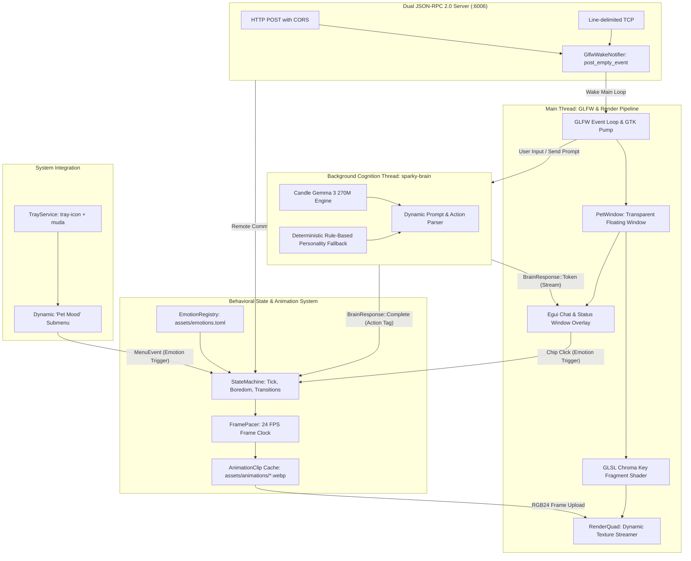

# 🐱 Sparky Desktop Pet

<p align="center">
  <strong>An ambient, ultra-low-resource hardware-accelerated desktop companion powered by Gemma 3 270M.</strong>
</p>

<p align="center">
  
  
  
  
  
  
</p>

---

## 📖 Overview

**Sparky** is an ambient desktop companion designed for developers and power users. Visually manifested as a spirited, expressive kitten, Sparky floats seamlessly over your desktop workspace without window borders, title bars, or rectangular backgrounds.

Unlike typical Electron or web-wrapper desktop pets that consume hundreds of megabytes of memory and trigger continuous CPU interrupts, Sparky is built from scratch in pure **Rust** with strict systems engineering principles:

1. **Direct GPU Chroma Keying:** Pre-rendered video animations on green-screen backgrounds are keyed out on the GPU in a single pass using a custom GLSL fragment shader (`shaders/chroma.frag`), completely bypassing CPU alpha decompression and software blitting.
2. **Local Embedded Cognition:** Powered by an embedded **Google Gemma 3 270M Instruction-Tuned (IT)** language model running locally on CPU via Hugging Face Candle. When weights are absent, a deterministic rule-based feline personality engine activates as a zero-dependency fallback.
3. **Data-Driven Emotion Architecture:** Behavior, loop modes, visual assets, fallback chains, and shader tints are declared dynamically in [`assets/emotions.toml`](assets/emotions.toml).
4. **Zero-Overhead Ambient Pacing:** Frame pacing strictly matches the 24 FPS animation rate, using `glfw.wait_events_timeout()` to sleep the main thread between frames, maintaining $\le 0.3\%$ idle CPU.
5. **Dual-Transport JSON-RPC 2.0 API:** Full remote automation and testing interface over both HTTP POST (with CORS) and raw TCP stream on port `6006`, powered by a GLFW wake notifier that maintains $\le 0.3\%$ CPU even during active listener standby.

---

## ⚡ Performance & Resource Invariants

| Metric / Subsystem | Hard Limit / Budget | Technical Implementation |
|:---|:---|:---|
| **Idle CPU (Sitting)** | $\le 0.3\%$ of 1 core | Event-driven sleep via `glfw.wait_events_timeout()` calculated from frame pacer. |
| **Active CPU (Animation)** | $\le 1.8\%$ of 1 core | 24 FPS clamp; hardware chroma-keying; zero CPU alpha rasterization. |
| **Hidden CPU (Tray)** | $0.00\%$ | GLFW window unmapped (`window.hide()`); render pipeline suspended; 100ms idle sleep. |
| **Resident Memory (RSS)** | $< 205\text{ MB}$ ($< 45\text{ MB}$ lazy) | Downscaled animation frames ($384 \times 216$ RGB24); memory-mapped safetensors (`mmap`). |
| **GPU Utilization** | $< 2.0\%$ on iGPU | Single textured quad VBO/VAO; no MSAA; simple chrominance distance math. |
| **Thread Affinity** | Main Thread Only for GL | All OpenGL and GLFW calls execute on the main thread; worker threads communicate via lock-free `crossbeam-channel`. |

---

## 🏗️ Architecture



---

## 🚀 Getting Started

### 1. Prerequisites (Linux)

Install the required development libraries:

```bash
# Ubuntu / Debian / Pop!_OS
sudo apt-get update && sudo apt-get install -y \
    build-essential cmake pkg-config \
    libglfw3-dev libgl1-mesa-dev libx11-dev libxcursor-dev \
    libxrandr-dev libxinerama-dev libxi-dev \
    libayatana-appindicator3-dev ffmpeg

# Fedora / RHEL
sudo dnf install -y \
    gcc gcc-c++ cmake pkgconf-pkg-config \
    glfw-devel mesa-libGL-devel libX11-devel libXcursor-devel \
    libXrandr-devel libXinerama-devel libXi-devel \
    libappindicator-gtk3-devel ffmpeg

# Arch Linux
sudo pacman -S --needed \
    base-devel cmake pkgconf glfw-x11 mesa \
    libx11 libxcursor libxrandr libxinerama libxi \
    libappindicator-gtk3 ffmpeg
```

### 2. Asset Preparation

Sparky ships with pre-transcoded WebP animations in `assets/animations/`. If you modify source video clips in `videos/*.mp4`, re-transcode them:

```bash
./scripts/transcode_assets.sh
```

This downscales the MP4 videos into $384 \times 216$ 24 FPS WebP animations optimized for low memory footprint.

### 3. Model Weights Setup (Optional)

Sparky includes an instant deterministic feline personality engine out of the box. To enable local generative inference via **Google Gemma 3 270M IT**:

```bash
./scripts/download_gemma3_270m.sh models/gemma-3-270m
```

*(Requires `huggingface-cli` or `python3 -m pip install huggingface_hub`).*

### 4. Build & Run

```bash
# Fast incremental debug build
cargo run

# Optimized release build (recommended for minimal resource footprint)
cargo run --release
```

---

## 🎮 Controls & Interactions

- **Left-Click & Drag:** Drag Sparky anywhere across your multi-monitor workspace. Uses displacement compensation for jitter-free positioning.
- **Right-Click:** Opens the conversational chat dialogue overlay.
- **Chat Window (`egui`):**
  - Type messages to Sparky (e.g., *"Good kitty!"*, *"Catch the laser!"*, *"Go to sleep"*).
  - Click emotion suggestion chips (`[😺 Happy]`, `[😼 Naughty]`, `[😾 Angry]`, `[💤 Sleep]`) to test behavioral responses.
- **System Tray Icon:**
  - **Show / Hide Sparky:** Suspends rendering and drops CPU to $0.00\%$.
  - **🐾 Pet Mood Submenu:** Switch between any emotion declared in `assets/emotions.toml`.
  - **Chat Window:** Toggle the chat panel.
  - **Quit:** Gracefully close Sparky.

---

## ⚙️ CLI Options & Flags

Sparky provides rich command-line configurability:

```text
Usage: sparky [OPTIONS]

Options:
      --profile-run                  Run automated 10-second benchmark and performance profiling session
      --emotions-config <PATH>       Path to emotions TOML configuration file [default: assets/emotions.toml]
      --animations-dir <PATH>        Path to directory containing WebP animation clips [default: assets/animations]
      --model-path <PATH>            Path to local Gemma 3 model weights directory [default: models/gemma-3-270m]
      --fps <FLOAT>                  Target animation playback frame rate in FPS [default: 24.0]
      --initial-emotion <NAME>       Starting emotion for the pet (e.g. sit, happy, angry, naughty)
      --click-through                Start in mouse click-through mode
      --rpc-addr <ADDR>              Bind address for the JSON-RPC 2.0 server [default: 127.0.0.1:6006]
      --no-rpc                       Disable the JSON-RPC server
  -h, --help                         Print help
  -V, --version                      Print version
```

---

## 🎨 Extensible Emotion Engine

Sparky uses a fully declarative, data-driven emotion architecture. Emotions are configured in [`assets/emotions.toml`](assets/emotions.toml):

```toml
[emotions.happy]
name = "Happy"
emoji = "😺"
asset = "happy.webp"
loop_mode = "OnceThenReturn"
return_to = "sit"
duration_secs = 8.0
prompt_description = "affectionate, praised, petted, ecstatic, purring"

[emotions.sad]
name = "Sad"
emoji = "😿"
asset = "sad.webp"
fallback = "sit"                          # Falls back to sit.webp if sad.webp is missing
shader_tint = [0.80, 0.85, 1.05]           # Cold blue tint applied on GPU
loop_mode = "OnceThenReturn"
return_to = "sit"
duration_secs = 10.0
prompt_description = "neglected, scolded, whimpering, lonely, drooping ears"
```

### Adding a Custom Emotion (Zero-Asset Fallback Recipe)

You can add new moods without any new video files by utilizing visual fallbacks and GPU shader tints:

```toml
[emotions.proud]
name = "Proud"
emoji = "🦁"
asset = "proud.webp"
fallback = "happy"
shader_tint = [1.15, 1.05, 0.85]          # Warm golden aura
loop_mode = "OnceThenReturn"
return_to = "sit"
duration_secs = 6.0
prompt_description = "triumphant, chest puffed out, accomplished, proud"
```

Once added to `assets/emotions.toml`:
1. The AI brain automatically recognizes `<action>proud</action>`.
2. The system tray dynamically appends `🦁 Proud` to the **Pet Mood** submenu.
3. The chat panel displays a `🦁 Proud` suggestion chip.
4. When activated, plays `happy.webp` with the golden shader tint and auto-returns to `sit`.

---

## 🌐 JSON-RPC 2.0 Automation API

Sparky exposes a dual-transport JSON-RPC 2.0 server on `127.0.0.1:6006` supporting both HTTP POST (with CORS headers) and raw TCP streams.

### Core Methods

| Method | Parameters | Description |
|:---|:---|:---|
| `sparky.get_state` | *None* | Returns active emotion, position, dimensions, frame index, and chat status. |
| `sparky.set_emotion` | `{"emotion": "happy"}` | Triggers a transition to the specified emotion. |
| `sparky.list_emotions` | *None* | Lists all registered emotions, emojis, and loop modes. |
| `sparky.pet` | *None* | Pets Sparky (triggers happy reaction). |
| `sparky.poke` | *None* | Pokes Sparky (triggers startled/angry reaction). |
| `sparky.send_chat` | `{"message": "Hello!"}` | Submits a chat prompt to Sparky's cognition engine. |
| `sparky.get_chat_history` | *None* | Returns full conversation history. |
| `sparky.clear_chat` | *None* | Clears conversation history. |
| `sparky.set_position` | `{"x": 100, "y": 200}` | Repositions the pet window on screen. |
| `sparky.get_position` | *None* | Returns current `{"x": ..., "y": ...}` window coordinates. |
| `sparky.set_visible` | `{"visible": false}` | Toggles pet window visibility (suspends rendering when hidden). |
| `sparky.set_click_through`| `{"click_through": true}` | Toggles mouse click-through transparency. |
| `sparky.get_frame` | `{"source": "raw", "save_path": "frame.png"}` | Captures raw animation frame or rendered quad as PNG / base64. |
| `rpc.discover` | *None* | Returns OpenRPC schema of all supported methods. |

### Example Invocations

#### Via HTTP (`curl`)
```bash
# Query pet state
curl -s -X POST http://127.0.0.1:6006/ \
  -H "Content-Type: application/json" \
  -d '{"jsonrpc": "2.0", "method": "sparky.get_state", "id": 1}'

# Trigger 'happy' emotion
curl -s -X POST http://127.0.0.1:6006/ \
  -H "Content-Type: application/json" \
  -d '{"jsonrpc": "2.0", "method": "sparky.set_emotion", "params": {"emotion": "happy"}, "id": 2}'

# Pet Sparky
curl -s -X POST http://127.0.0.1:6006/ \
  -H "Content-Type: application/json" \
  -d '{"jsonrpc": "2.0", "method": "sparky.pet", "id": 3}'
```

#### Via Raw TCP (`nc`)
```bash
echo '{"jsonrpc":"2.0","method":"sparky.get_state","id":1}' | nc -N 127.0.0.1 6006
```

---

## 🧪 Testing & Verification

Run the comprehensive test suite (all unit tests, CLI tests, protocol tests, and behavioral tests):

```bash
# Run unit & integration tests
cargo test --release

# Run behavioral test harness with live ANSI terminal frame visualizers
cargo test rpc::behavior_tests -- --nocapture

# Run 10-second automated profiling benchmark session
cargo run --release -- --profile-run
```

---

## 📦 Standalone AppImage Packaging

Sparky includes an automated packaging pipeline to create a self-contained, portable Linux AppImage:

```bash
# 1. Build optimized release binary
cargo build --release

# 2. Package AppImage with assets and shaders bundled
./scripts/package_appimage.sh target/release/sparky

# 3. Package and run validation tests immediately
./scripts/package_appimage.sh --test target/release/sparky
```

The output `Sparky-x86_64.AppImage` runs on any modern Linux distribution without installing dependencies.

---

## 📁 Repository Anatomy

```text
sparky/
├── Cargo.toml                  # Dependencies & release profiles (opt-level 3, thin LTO, strip)
├── DESIGN.md                   # Full architectural specification & mathematical formulations
├── IMPLEMENTATION.md           # Implementation notes & verification checklists
├── AGENTS.md                   # Authoritative operational guide for AI agents
├── README.md                   # (This file) Project documentation & quickstart
│
├── assets/
│   ├── animations/             # Transcoded 384x216 WebP animation frames (24 FPS)
│   ├── emotions.toml           # Declarative emotion schema, loop rules & shader tints
│   └── icons/                  # System tray icons
│
├── shaders/
│   ├── quad.vert               # Textured quad vertex shader with UV Y-flip
│   └── chroma.frag             # CbCr chrominance distance keyer with despill & emotion tint
│
├── scripts/
│   ├── download_gemma3_270m.sh # Downloader for Gemma 3 270M safetensors and tokenizer
│   ├── transcode_assets.sh     # ffmpeg batch transcoding pipeline (MP4 -> WebP)
│   └── package_appimage.sh     # Automated Linux AppImage packaging & validation tool
│
└── src/
    ├── main.rs                 # Event loop, OpenGL context, window geometry & compositor
    ├── cli.rs                  # Clap command-line interface arguments & parser tests
    ├── animation/              # WebP decoding into raw RGB24 frames & 24 FPS frame pacer
    ├── brain/                  # Candle Gemma 3 270M local inference & rule-based fallback
    ├── render/                 # GLFW windowing, transparent quad VAO/VBO & GLSL shader manager
    ├── rpc/                    # JSON-RPC 2.0 dual HTTP/TCP server & behavioral test suite
    ├── state/                  # Declarative emotion registry & state transition machine
    ├── tray/                   # System tray integration (tray-icon + muda + GTK event pump)
    └── ui/                     # Egui chat dialogue overlay, suggestion chips & badge renderer
```

---

## 📄 License

Licensed under either of:
- Apache License, Version 2.0 ([LICENSE-APACHE](LICENSE-APACHE) or <http://www.apache.org/licenses/LICENSE-2.0>)
- MIT license ([LICENSE-MIT](LICENSE-MIT) or <http://opensource.org/licenses/MIT>)

at your option.
